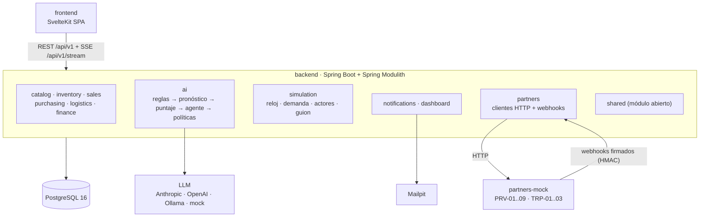

# Arquitectura

Resumen de las secciones 4 y 5 de `AGENTS.md`, que siguen siendo la fuente de verdad. Este documento se amplía a medida que se implementan los módulos.

## Vista general

Xperp es un monolito modular, con un servicio aparte que simula a los socios externos.

## Reglas de dependencia

- Un módulo solo puede usar `api/` y `events/` de otro módulo. `ModularityTest` lo verifica en cada build.
- Dentro de un módulo, las dependencias van `web → service → repository`.
- Los módulos se comunican por eventos de dominio persistidos (`event_publication`). El catálogo está en `contracts/events.md`.
- La IA propone, el backend valida y la política decide. El LLM nunca toca la base de datos; las tools pasan por `ActionGateway`.

## Contrato primero

1. Se cambia `contracts/openapi/` en un PR `contract/...`.
2. El backend empaqueta el contrato y genera interfaces en `com.xperp.shared.contract.api`. Los controllers de `web/` las implementan; si se apartan del contrato, no compilan.
3. El frontend genera `schema.d.ts` con `npm run gen:api` y crea los handlers de MSW.

## Documentación generada de módulos

`ModularityTest` escribe diagramas PlantUML de los módulos en `backend/target/spring-modulith-docs/`.
