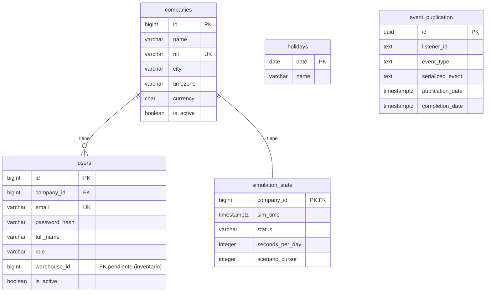

# Modelo entidad-relación

Modelo de datos de la sección 6 de `AGENTS.md`. Cada diagrama se actualiza en el mismo PR que la migración que cambia el esquema.

## Plataforma (V1)

## Pendiente

Estos diagramas se agregan cuando llegue la migración de cada módulo: catálogo (6.2), inventario (6.3), ventas (6.4), compras (6.5), logística (6.6), finanzas (6.7) e IA y control (6.8).
